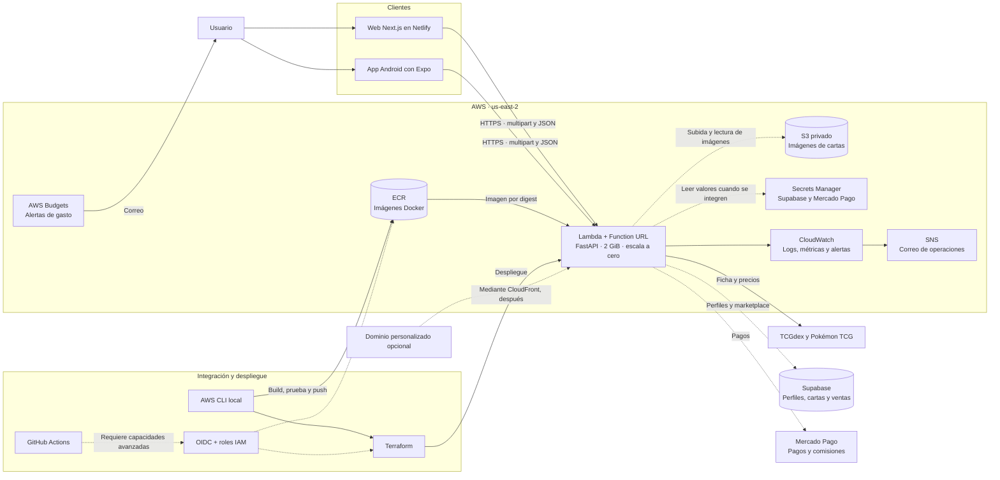

# Arquitectura de Virtual Binder

Las líneas continuas representan el flujo del escáner actual. Las líneas punteadas indican recursos provisionados, integraciones futuras o automatización que requiere capacidades avanzadas de AWS.

## Estado de las integraciones

- **Operativo con el despliegue:** Lambda, Function URL, ECR, consulta de fuentes externas, logs, métricas, presupuesto y URL HTTPS proporcionada por AWS.
- **Provisionado, pendiente de código:** bucket de imágenes y lectura de secretos.
- **Bloqueado por la política actual del proyecto:** OIDC para CI/CD; el despliegue inicial se realiza con AWS CLI.
- **Etapas posteriores:** Supabase, perfiles, marketplace, Mercado Pago y dominio personalizado mediante CloudFront.
- **Fuera de AWS:** Netlify continúa alojando la web y Expo/EAS se usa para Android.
